# Diagrammes UML de Reboot

Ces diagrammes décrivent le code tel qu'il est dans `src/main/java/com/reboot/model`. Ils ont d'abord servi de plan (première version tirée du GDD), puis ont été remis à jour pour correspondre au code réel : mêmes noms de classes, de méthodes et de paquets.

Les diagrammes sont écrits en Mermaid : GitHub les affiche directement, et ils se modifient comme du texte. Pour garder la doc juste, une PR qui ajoute, renomme ou déplace une classe met aussi ce fichier à jour.

Le modèle ne dépend pas de JavaFX : les vues (`com.reboot.view`) et `GameController` lisent le modèle et le pilotent, mais le modèle ne les connaît pas. Tout ce qui est décrit ici se teste avec JUnit sans ouvrir de fenêtre.

| # | Diagramme | Paquet(s) | Design pattern |
| --- | --- | --- | --- |
| 1 | [Combattants et compétences](#1-combattants-et-compétences) | `fighter`, `skill` | Héritage, polymorphisme, Decorator |
| 2 | [États d'un robot](#2-états-dun-robot) | `fighter` | State |
| 3 | [Combat](#3-combat) | `combat` | Strategy |
| 4 | [Conséquences du choix](#4-conséquences-du-choix) | `event`, `nexus`, `team`, `game` | Observer |
| 5 | [Partie, équipe et monde](#5-partie-équipe-et-monde) | `game`, `team`, `world`, `fighter` | Composition, Factory |
| 6 | [Quêtes et campagne](#6-quêtes-et-campagne) | `quest` | Composite |
| 7 | [Réglages et souvenirs](#7-réglages-et-souvenirs) | `settings`, `story` | Aucun |
| 8 | [Séquence : un tour de combat](#8-séquence--un-tour-de-combat) | `combat`, `skill` | Strategy |
| 9 | [Séquence : reprogrammer ou achever](#9-séquence--reprogrammer-ou-achever) | `game`, `event` | State + Observer |
| 10 | [Enchaînement des écrans](#10-enchaînement-des-écrans) | `view` | Template Method |

## 1. Combattants et compétences

`Combattant` porte ce qui est commun à tout ce qui se bat : stats, PV, XP, compétences. Les stats se calculent à partir des stats de base et du niveau (+ 10 % de la base par niveau). Les robots et les exosquelettes connaissent tous la Frappe (`Combattant.STRIKE`) : `Robot` et `Exosquelette` l'ajoutent à leurs compétences.

Deux branches en héritent. Les `Robot` ont un type et un état, et peuvent être reprogrammés. Les `Exosquelette` sont pilotés par des humains : `isReprogrammable()` renvoie `false`. Le chef de NEXUS est un `Boss`, un exosquelette créé au niveau fixe `FIXED_LEVEL` (10), qui redéfinit `endsTheGame()` pour terminer la partie quand il est vaincu.

Le polymorphisme est partout : `isReprogrammable()` et `getSpriteId()` sont abstraites dans `Combattant` et chaque branche répond à sa façon ; `advantageAgainst()` et `weaknessTo()` ne donnent le bonus de type × 1,5 qu'entre robots, sans aucun `instanceof`.

Chaque compétence est un objet `Skill` qui applique son propre effet dans `apply()` : en ajouter une ne demande de toucher à aucune classe de robot. `OncePerCombatSkill` est un Decorator : il enveloppe n'importe quelle compétence pour la rendre utilisable une seule fois par combat (la Surcharge des exosquelettes).

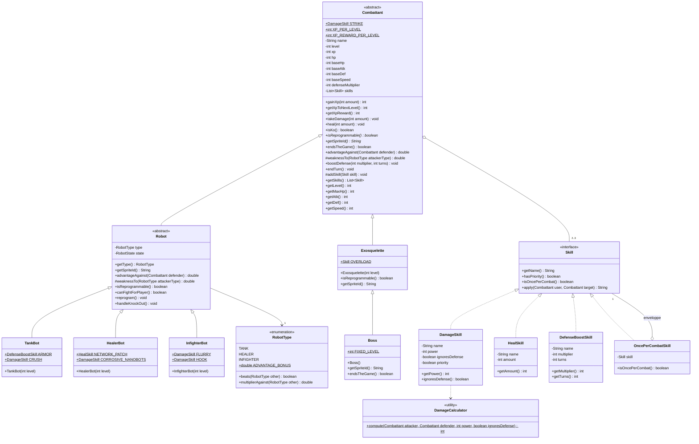

Correspondance avec les compétences du GDD :

| Compétence | Classe | Réglage |
| --- | --- | --- |
| Frappe (`Combattant.STRIKE`), Écrasement, Rafale de coups | `DamageSkill` | puissance 10, 16, 16 |
| Nanobots corrosifs | `DamageSkill` | puissance 12, `ignoresDefense` |
| Crochet | `DamageSkill` | puissance 12, `priority` |
| Surcharge (`Exosquelette.OVERLOAD`) | `OncePerCombatSkill` autour d'un `DamageSkill` | puissance 18, une fois par combat |
| Patch réseau | `HealSkill` | 15 PV |
| Blindage | `DefenseBoostSkill` | DEF × 2 pendant 2 tours |

`DamageCalculator.compute()` applique la formule du GDD : `max(1, puissance + ATK − DEF)`, la DEF étant ignorée si la compétence le permet, puis × 1,5 arrondi à l'entier inférieur si le type de l'attaquant bat celui du défenseur.

## 2. États d'un robot

Un ennemi et un allié sont la même classe `Robot` : seul son état change. `Robot` délègue à son `RobotState` tout ce qui dépend de l'état, au lieu d'empiler des `if`. Chaque événement (`onReprogram`, `onKnockOut`…) renvoie l'état suivant ; une transition interdite (reprogrammer un allié) lance une `IllegalStateException`.

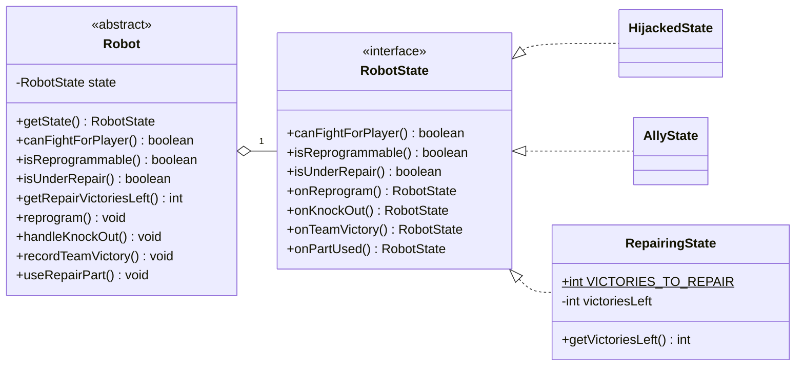

Les transitions entre états :

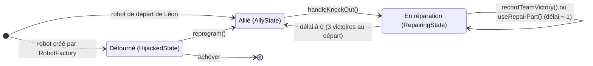

## 3. Combat

`Combat` ne connaît ni JavaFX ni la carte : il se teste seul. `Encounter` crée le combat et en tire un `EncounterResult` : le choix reprogrammer / achever n'est proposé qu'après une victoire contre un ennemi reprogrammable (`isReprogrammable()`, polymorphe). `CombatLauncher` est la frontière entre l'exploration et le combat : `GameController` l'implémente.

L'IA ennemie suit le pattern Strategy : `Combat` demande sa compétence à une `CombatStrategy` sans savoir comment elle décide. `FirstSkillStrategy` (toujours la première compétence) est la stratégie par défaut ; en jeu, `GameController` donne une `RandomStrategy`, qui reçoit son générateur aléatoire par le constructeur pour que les tests soient reproductibles. `Combat` ne donne à la stratégie que les compétences encore utilisables : une compétence à usage unique (`isOncePerCombat()`) déjà lancée, comme la Surcharge, en est retirée.

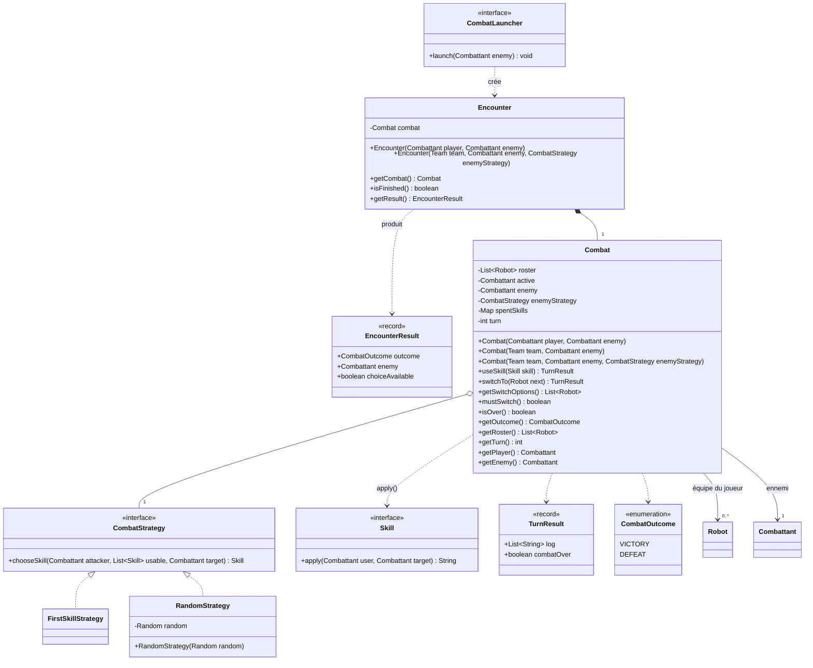

`Combat` ne calcule pas les dégâts lui-même : il appelle `Skill.apply()`, et chaque compétence applique son effet (section 1). Quand l'ennemi tombe, le robot qui l'a mis K.O. gagne de l'XP (`gainXp()`). `OffensiveStrategy` (IA offensive selon la barre de recherche) reste un bonus COULD, non codé.

## 4. Conséquences du choix

Reprogrammer ou achever (`ChoiceResolver`) et neutraliser un pilote (`Game.onCombatEnd()`) publient chacun un événement sur l'`EventBus` : la barre de recherche bouge dans les trois cas, donc il y a trois événements. Ceux qui en dépendent s'abonnent : `ChoiceResolver` et le combat ne connaissent ni le réseau, ni la barre de recherche, ni le stock de pièces.

Chaque événement sait à quelle méthode de l'abonné il correspond (`dispatchTo()`) : l'`EventBus` n'a donc aucun `if` sur le type d'événement. `GameEventListener` a une méthode par événement, et chaque abonné ne redéfinit que celles qui l'intéressent.

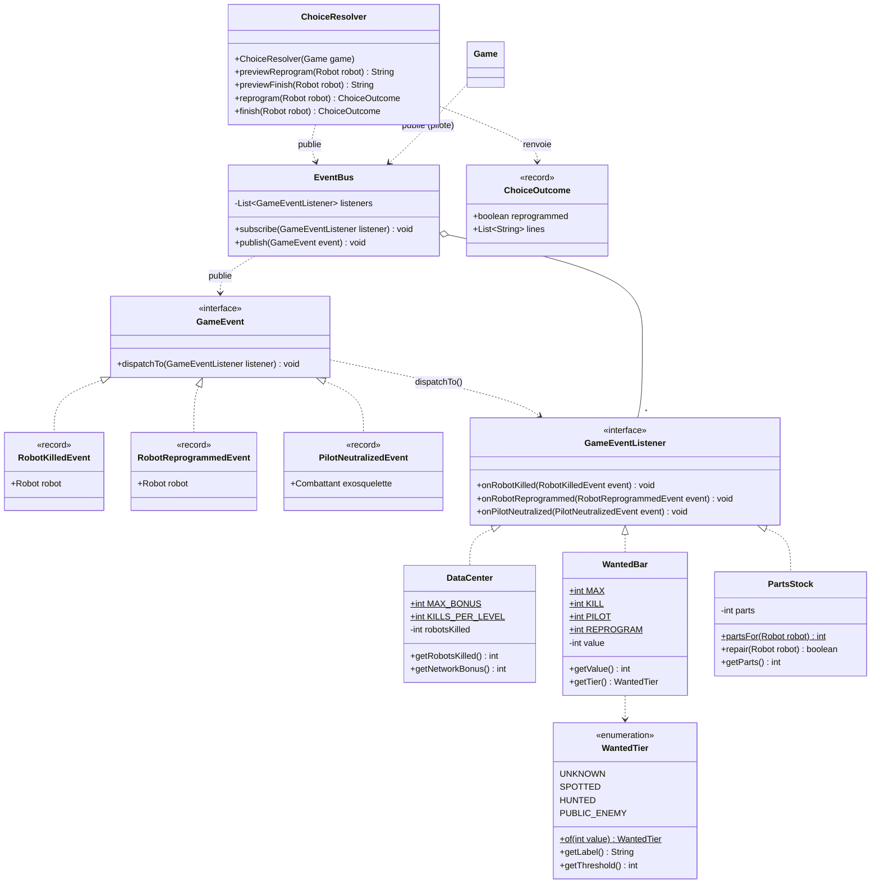

| Événement | `DataCenter` | `WantedBar` | `PartsStock` |
| --- | --- | --- | --- |
| `RobotKilledEvent` | robots achevés + 1 | + 15 | + `partsFor(robot)` pièces (1 + niveau / 3) |
| `RobotReprogrammedEvent` | Aucun effet | − 5 | Aucun effet |
| `PilotNeutralizedEvent` | Aucun effet | + 10 | Aucun effet |

Le bonus du réseau vaut `min(MAX_BONUS, robotsAchevés / KILLS_PER_LEVEL)`, soit `min(5, robotsAchevés / 3)`, et la barre reste entre 0 et 100. Ses paliers : Inconnu (0), Repéré (25), Traqué (50), Ennemi public (75).

## 5. Partie, équipe et monde

`Game` est le point d'entrée du modèle : il possède l'équipe, la Home, la campagne et les abonnés de l'`EventBus`, et réagit à la fin de chaque combat (`onCombatEnd()`). Les zones ne sont pas des objets : ce sont des numéros (`Campaign.HOME`, `RESIDENTIAL`, `INDUSTRIAL`, `DATA_CENTER`).

`Team` contient 3 robots au plus ; la `Home` stocke les autres et les échange avec l'équipe. `RobotFactory` est le seul endroit qui fabrique les robots des rencontres, au niveau de la zone plus le bonus du réseau (`encounterLevel()`).

Côté monde, `TileMap` est chargée depuis un fichier texte ; `Player` s'y déplace case par case, et `EncounterTrigger` décide si une case de rencontre lance un combat (avec un `Random` injecté). C'est `GameController` qui relie le monde et la partie.

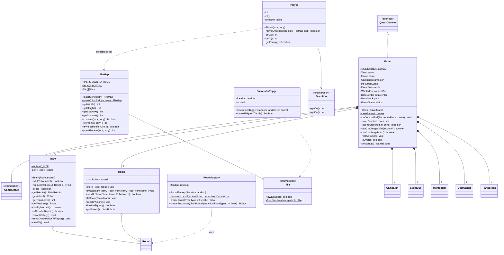

## 6. Quêtes et campagne

La progression suit le pattern Composite : une `QuestGroup` (un chapitre) est elle-même une `Quest`, faite d'autres quêtes. La vue des quêtes affiche un chapitre et une quête simple de la même façon, sans savoir laquelle elle a en main.

Les quêtes ne connaissent pas `Game` : elles lisent la partie à travers l'interface `QuestContext` (victoires par zone, taille et niveau de l'équipe, chefs vaincus…), que `Game` implémente. `Campaign` décide quelles zones sont débloquées et quand on peut défier un chef ou le boss. Le data center est gardé par `DISCREET_GUARDS` (1) garde tant que la barre de recherche reste sous `DISCREET_ENTRY_LIMIT` (75), et par `MAIN_GUARDS` (3) au-delà (`guardsFor()`).

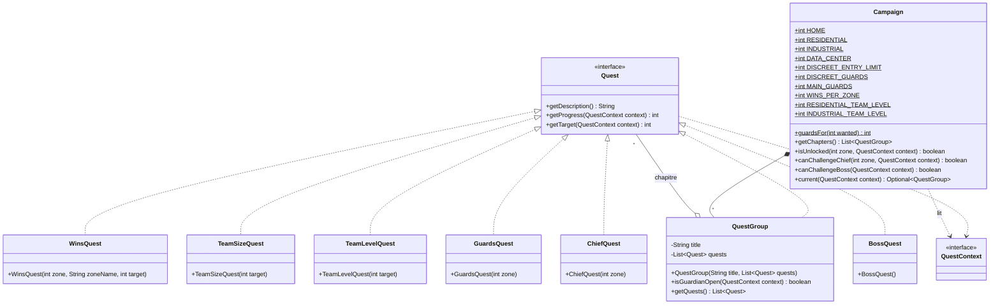

## 7. Réglages et souvenirs

Les réglages du joueur (taille de fenêtre, plein écran, luminosité, touches) sont un modèle à part, enregistré sous forme de `Properties`. `MemoryBook` charge les souvenirs des robots depuis un fichier texte et en tire un au hasard selon le type du robot, pour l'écran de choix.

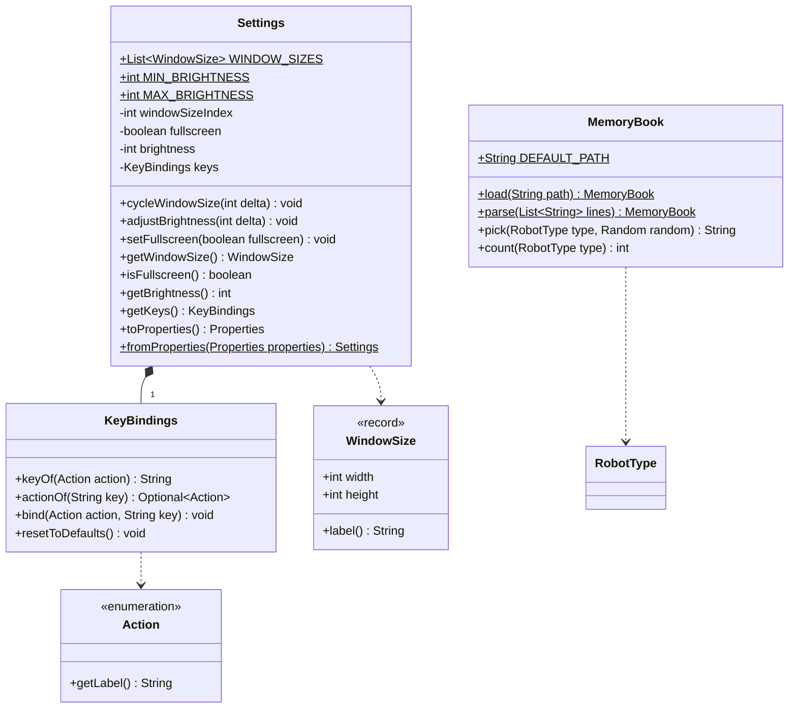

## 8. Séquence : un tour de combat

Le joueur choisit une compétence. Le plus rapide joue en premier, sauf si une compétence est prioritaire (Crochet). Si le premier met l'autre K.O., il n'y a pas de riposte.

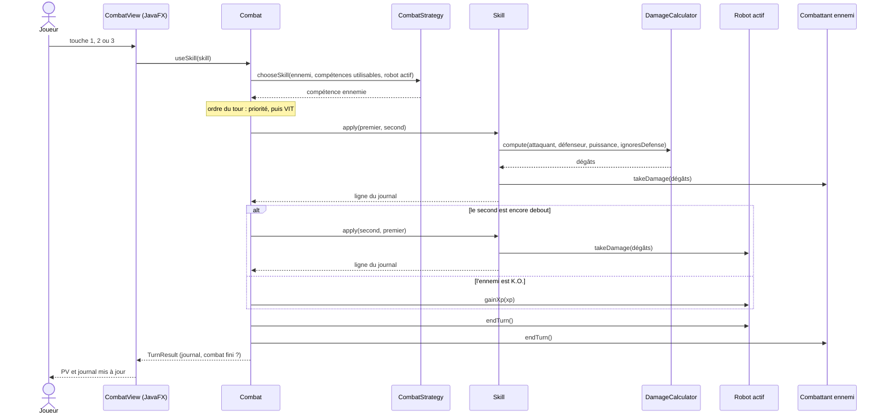

À la fin du combat, `Game.onCombatEnd()` enregistre la victoire ou la défaite ; les robots K.O. de l'équipe passent en réparation (`Team.sendKnockedOutToRepair()`, donc `handleKnockOut()` et le State de la section 2).

## 9. Séquence : reprogrammer ou achever

La scène phare : après une victoire contre un robot, le joueur choisit. Les deux branches montrent le State (le robot change d'état) et l'Observer (les conséquences se propagent seules).

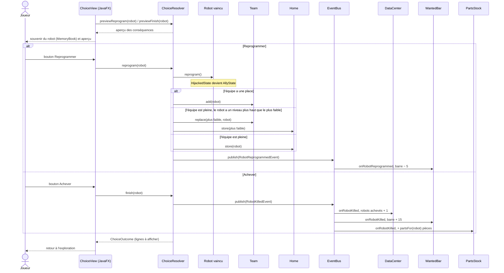

## 10. Enchaînement des écrans

La boucle de jeu, vue comme une suite d'écrans. Chaque écran est une vue de `com.reboot.view` ; `GameController` passe de l'une à l'autre. Options et Quêtes reviennent à l'écran d'où on les a ouverts.

`MenuView` n'est pas un écran : c'est la classe abstraite dont héritent `MainMenuView`, `PauseView`, `QuestsView`, `OptionsView` et `HomeView` (pattern Template Method). Elle gère la navigation au clavier, et chaque menu ne fournit que ses entrées.

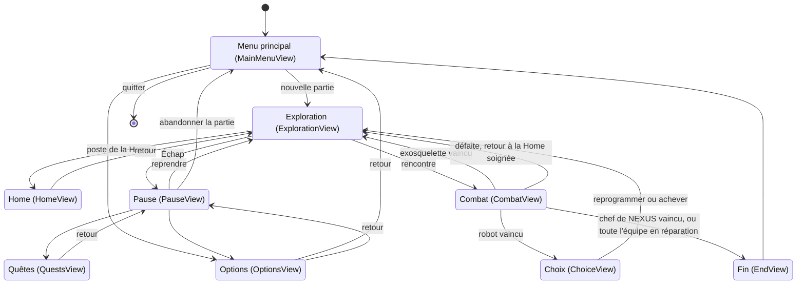

## Ce qui n'est pas codé

Ces éléments du GDD n'existent pas dans le code, et n'apparaissent donc pas dans les diagrammes (ou y sont signalés) :

1. **`OffensiveStrategy`** (COULD) : une IA plus offensive quand la barre de recherche est haute. La Strategy de la section 3 permet de l'ajouter sans toucher à `Combat`.
2. **Les effets des paliers de la barre** (SHOULD) : le palier est calculé (`WantedTier`), mais seul « Ennemi public » a un effet : le data center est gardé par 3 gardes au lieu d'un (`Campaign.guardsFor()`).
3. **Pas de classe `Zone`** : une zone est un numéro de `Campaign`, sa carte une `TileMap`.

## Déjà tranché

- **Surcharge une fois par combat** : `OncePerCombatSkill` (pattern Decorator) marque la compétence, et `Combat` retient celles déjà lancées. N'importe quelle compétence peut devenir à usage unique sans toucher à `Exosquelette`.
- **`Boss` hérite d'`Exosquelette`**, et non de `Robot` : le chef de NEXUS est un humain en exosquelette, jamais reprogrammable et sans état « Détourné ». Il est créé au niveau fixe 10 et redéfinit `endsTheGame()`.
- **Trois événements** : `RobotKilledEvent`, `RobotReprogrammedEvent` et `PilotNeutralizedEvent`, parce que la barre de recherche bouge aussi quand on reprogramme (− 5) ou qu'on neutralise un pilote (+ 10).
- **Pas d'`instanceof` pour le bonus de type ni pour le choix** : `advantageAgainst()` / `weaknessTo()` et `isReprogrammable()` sont redéfinies par chaque branche.
